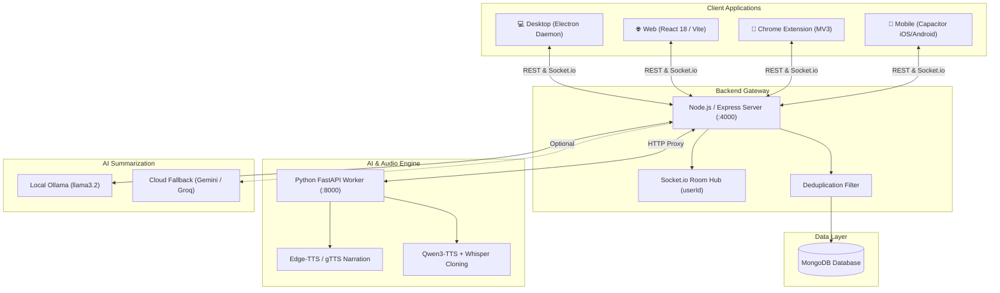

# 📋 ClipVault

<div align="center">

### **Cross-Platform Real-Time Clipboard Synchronization & Workspace**

Synchronize clipboard content across **Web**, **Desktop**, **Mobile**, and **Browser Extension** clients with Socket.io real-time streaming, smart deduplication, rich-text notebooks, and AI-assisted narration.

[](https://www.typescriptlang.org/)
[](https://react.dev/)
[](https://www.electronjs.org/)
[-119EFF?style=for-the-badge&logo=capacitor&logoColor=white)](https://capacitorjs.com/)
[](https://developer.chrome.com/docs/extensions/mv3/)
[](https://expressjs.com/)
[](https://fastapi.tiangolo.com/)
[](https://www.mongodb.com/)
[](https://socket.io/)

[Overview](#-overview) • [Supported Platforms](#-supported-platforms) • [Key Features](#-key-features) • [Architecture](#-architecture) • [Technical Decisions](#-technical-decisions) • [Known Limitations](#-known-limitations--design-boundaries) • [Setup Guide](#-setup-guide)

</div>

---

## 📖 Overview

**ClipVault** is a cross-platform clipboard synchronization ecosystem designed to solve fragmented copy-pasting across different operating systems. Instead of emailing links to yourself or keeping temporary messaging threads to move snippets between devices, ClipVault unifies your clipboard into a single, synchronized stream.

Built with **React, Electron, Capacitor, Node.js/Express, MongoDB, and Socket.io**, any text snippet copied on one device is captured and broadcast in real-time to all your other connected clients. Beyond real-time clipboard sync, ClipVault provides categorized rich-text notebooks, AI summarization, and neural text-to-speech narration.

---

## 📱 Supported Platforms

Cross-platform consistency is the core differentiator of ClipVault. The client codebase is organized as a monorepo with shared TypeScript contracts, driving four purpose-built platform targets:

| Platform | Client Target | Core Technologies | Synchronization Mechanism |
| :--- | :--- | :--- | :--- |
| **Desktop** | Native Desktop App | Electron 28, TypeScript | **OS Background Daemon:** Polling daemon checks `clipboard.readText()` every 500ms; includes system tray pause controls and global hotkey (`Cmd/Ctrl + Shift + V`). |
| **Web** | Responsive Web App | React 18, Vite, Tailwind CSS, TipTap | **Focus-Aware Listener:** Syncs clipboard content when the browser document gains active focus, respecting browser security policies. |
| **Mobile** | Native Mobile App | Capacitor (iOS & Android) | **App-Resume & Foreground Sync:** Uses `@capacitor/clipboard` to detect new clips when the application is active or brought to the foreground. |
| **Extension** | Browser Extension | Chrome Manifest V3, CRXJS | **DOM Copy Interceptor:** Content script listens to in-page `copy` events and captures selected text with source domain attribution. |

---

## ✨ Key Features

### 1. Cross-Device Clipboard Synchronization
Copy text on your desktop or browser and have it immediately available on your mobile device or web dashboard. Each clip tracks metadata including word count, character count, timestamp, and source origin (e.g. `Desktop`, `Mobile`, or the specific website captured by the extension).

### 2. Real-Time Updates via Socket.io
Clipboard operations avoid aggressive HTTP polling across devices:
- When any client creates, updates, or deletes a clip, the Express backend broadcasts the event (`new_clipboard_item`, `update_clipboard_item`, `delete_clipboard_item`) directly to a private user room (`io.to(userId)`).
- Connected clients update their UI state instantaneously with zero round-trip polling delay.

### 3. Environment-Aware Clipboard Monitoring
Rather than attempting a one-size-fits-all approach, each platform uses a monitoring strategy adapted to its operating system security model:
- **Desktop (Electron):** True native OS clipboard polling with pause/resume toggle in the system tray.
- **Extension (Chrome MV3):** Intercepts `copy` events directly within web pages with selection fallbacks.
- **Mobile (Capacitor) & Web:** Checks the clipboard upon active focus/resume, ensuring compliance with mobile OS privacy sandboxes (iOS 14+, Android 10+).

### 4. Two-Tier Duplicate-Write Detection
Background clipboard listeners can easily trigger infinite feedback loops: Device A copies $\to$ syncs to server $\to$ broadcasts to Device B $\to$ Device B writes to OS pasteboard $\to$ Device B detects a new copy $\to$ sends to server again.

ClipVault prevents this through a two-tier defense:
1. **Client-Side Deduplication:** In-memory caching (`lastCopiedText`) filters out redundant reads before sending an HTTP request.
2. **Server-Side Verification:** The backend checks the user's latest saved entry (`lastItem.text === text`). If identical, it returns `200 OK` and suppresses further socket broadcasts, completely avoiding infinite write storms.

### 5. Text-to-Speech & Voice Cloning
- **Standard Neural TTS:** High-quality narration using Microsoft Edge neural voices across American, British, and Indian accents (male and female) with automatic fallback to `gTTS`.
- **Voice Cloning (Experimental):** A dedicated Python FastAPI worker integrating **Qwen3-TTS** and **OpenAI Whisper** for reference audio conditioning and sentence chunking with natural pause stitching.

### 6. AI Summarization & Knowledge Organization
- Summarizes clipboard history or notebook entries into bulleted digests, executive summaries, or action items.
- Supports local inference via **Ollama** (`llama3.2:3b`) with optional fallbacks to **Google Gemini** or **Groq Cloud API**.
- Full WYSIWYG rich text notebooks built with TipTap, markdown support, and task/todo management.

---

## 🏛️ Architecture

ClipVault decouples high-frequency clipboard I/O from compute-heavy AI tasks through a modular service structure:

```
                            ┌────────────────────────────────────────┐
                            │           CLIENT ECOSYSTEM             │
                            │         (Turborepo Monorepo)           │
                            └───────────────────┬────────────────────┘
             ┌─────────────────────┬────────────┴────────────┬─────────────────────┐
             │                     │                         │                     │
             ▼                     ▼                         ▼                     ▼
┌────────────────────────┐ ┌───────────────┐ ┌──────────────────────┐ ┌────────────────────────┐
│     Desktop Client     │ │  Web Client   │ │   Chrome Extension   │ │     Mobile Client      │
│ Electron Tray Daemon   │ │ React 18/Vite │ │  Manifest V3 Worker  │ │ Capacitor (iOS/Android)│
│ Hotkey: Ctrl+Shift+V   │ │ Focus Sync    │ │ DOM Copy Sniffer     │ │ App-Resume Sync        │
└────────────┬───────────┘ └───────┬───────┘ └──────────┬───────────┘ └───────────┬────────────┘
             │                     │                    │                         │
             └─────────────────────┼────────────────────┴─────────────────────────┘
                                   │
                                   │  HTTP REST (Auth, Clips, DTOs) &
                                   │  WebSocket (Socket.io Real-Time Rooms)
                                   ▼
                      ┌─────────────────────────┐
                      │  Node.js / Express API  │
                      │       (Port 4000)       │
                      │  • JWT Authentication   │
                      │  • Deduplication Engine │
                      │  • Socket.io Room Sync  │
                      │  • Helmet & Rate Limit  │
                      └────────────┬────────────┘
                                   │
              ┌────────────────────┴────────────────────┐
              │                                         │
              ▼                                         ▼
  ┌────────────────────────┐              ┌───────────────────────────┐
  │    MongoDB Database    │              │  Python FastAPI AI Engine │
  │       (Mongoose)       │              │        (Port 8000)        │
  │ • Users & Preferences  │              │ • Edge-TTS & gTTS Voices  │
  │ • Clipboard Items      │              │ • Qwen3-TTS Voice Clone   │
  │ • Notebooks & Todos    │              │ • Whisper Transcription   │
  └────────────────────────┘              └─────────────┬─────────────┘
                                                        │
                                    ┌───────────────────┴───────────────────┐
                                    ▼                                       ▼
                      ┌──────────────────────────┐            ┌───────────────────────────┐
                      │    Local LLM (Ollama)    │            │   Cloud LLMs (Fallback)   │
                      │       llama3.2:3b        │            │ Google Gemini / Groq API  │
                      └──────────────────────────┘            └───────────────────────────┘
```

### Architecture Flow



---

## 💡 Technical Decisions & Trade-Offs

### 1. Why Shared TypeScript DTOs?
- **Problem:** Maintaining four client applications (Web, Desktop, Extension, Mobile) alongside a Node.js backend can quickly cause contract drift (e.g. mismatched property names, missing optional fields, or outdated timestamps).
- **Solution:** Domain models (`ClipboardItem`, `Notebook`, `User`, `AuthResponse`) are defined in a shared package (`@clipvault/shared`). Any contract modification is validated at compile-time across all client packages simultaneously.

### 2. Why Socket.io over Polling or Raw WebSockets?
- **Room-Based Isolation:** Socket.io allows partitioning client connections into authenticated private user rooms (`socket.join(userId)`). When a clip is created or modified, the backend emits the event only to that specific user's connected devices without cross-tenant leakage.
- **Connection Resilience:** Built-in heartbeats, automatic reconnection backoff, and transparent HTTP long-polling fallback ensure clients reconnect gracefully across desktop sleep states or mobile network transitions.

### 3. Why Duplicate-Write Detection?
- **The "Ping-Pong" Loop Hazard:** When Device A saves a clip, the server broadcasts it to Device B. If Device B writes it to its local clipboard, an unconstrained background listener would see a new clipboard entry and attempt to send it back to the server, resulting in an infinite write loop.
- **Solution:** Clients maintain a local memory cache of `lastCopiedText`, and the server compares incoming items against the user's most recent database record (`findOne().sort({ createdAt: -1 })`). If the text matches, the server returns the existing item with `200 OK` and skips socket broadcasting.

### 4. Why Decouple the Python AI Worker from the Node.js API?
- Heavy audio generation and voice synthesis require CPU/GPU matrix computations. Executing inference directly inside Node.js worker threads risks blocking the single-threaded event loop, degrading API response times and Socket.io ping intervals.
- Offloading audio synthesis to a standalone FastAPI worker keeps the Express API gateway lean, responsive, and horizontally scalable.

---

## ⚠️ Known Limitations & Design Boundaries

To maintain technical transparency and realistic production expectations:

1. **OS Background Clipboard Restrictions (Mobile & Web):**
   - Modern mobile platforms (iOS 14+, Android 10+) and web browsers intentionally restrict background clipboard reading to prevent unauthorized snooping. As a result, **mobile and web clients synchronize when the app is active or brought to the foreground**. Only the desktop Electron client operates as a true native OS background daemon.
2. **Text-Only Content:**
   - The current synchronization pipeline is built for plain text, formatted HTML, URLs, and code snippets. Binary clipboard objects (such as raw image bitmaps or arbitrary file attachments) are not supported.
3. **Network Dependency for Real-Time Sync:**
   - Synchronization relies on an active internet/network connection to the Socket.io server. If a device goes offline, new clips are held in client state; complex offline merge conflict resolution (e.g. CRDTs) is not implemented.
4. **Hardware Requirements for Local AI:**
   - Local LLM summarization (Ollama) and neural voice cloning (Qwen3-TTS) require significant local CPU/GPU and RAM resources. In resource-constrained environments, standard Edge-TTS and cloud LLM APIs should be used instead.

---

## 🚀 Setup Guide

### Prerequisites
- **Node.js**: `v20.x` or higher
- **npm**: `v10.x` or higher
- **Python**: `v3.10` or higher
- **MongoDB**: Local MongoDB instance (`mongodb://localhost:27017`) or a MongoDB Atlas URI
- *(Optional)* **Ollama**: For local AI summaries (`ollama run llama3.2:3b`)

---

### 1. Backend Server Setup (Node.js & Express)

```bash
# 1. Navigate to the server directory
cd server

# 2. Install dependencies
npm install

# 3. Create .env configuration
cp .env.example .env
```

Configure your `server/.env`:
```env
PORT=4000
MONGO_URI=mongodb://localhost:27017/clipvault
JWT_SECRET=your_super_secret_jwt_key
PYTHON_WORKER_URL=http://127.0.0.1:8000
OLLAMA_BASE_URL=http://127.0.0.1:11434
OLLAMA_MODEL=llama3.2:3b
GEMINI_API_KEY=your_optional_gemini_key
GROQ_API_KEY=your_optional_groq_key
```

```bash
# 4. Start the backend in development mode
npm run dev
```
*The API gateway and Socket.io server will start on `http://localhost:4000`.*

---

### 2. Python AI & Audio Worker Setup (FastAPI)

In a new terminal:
```bash
# 1. Navigate to the python engine directory
cd server/python_engine

# 2. Create and activate a virtual environment
python3 -m venv venv
source venv/bin/activate    # On Windows: venv\Scripts\activate

# 3. Install required packages
pip install fastapi uvicorn torch soundfile edge-tts gTTS numpy

# Optional: For local voice cloning and Whisper transcription:
# pip install openai-whisper qwen-tts

# 4. Run the worker
python3 tts_worker.py
```
*The AI audio worker will start on `http://127.0.0.1:8000`.*

---

### 3. Client Monorepo Setup

From the root of the repository:
```bash
# Navigate to the client monorepo
cd client

# Install dependencies
npm install
```

#### Running Clients:

* **Web Application:**
  ```bash
  cd client/apps/web
  npm run dev
  # Accessible at: http://localhost:5173
  ```

* **Electron Desktop Client:**
  ```bash
  # Ensure the Web app is running, then in another terminal:
  cd client/apps/desktop
  npm run dev
  # Desktop window and system tray icon will appear
  ```

* **Chrome Browser Extension:**
  ```bash
  cd client/apps/extension
  npm run build
  # Or run in development watch mode: npm run dev
  ```
  1. Open Google Chrome and navigate to `chrome://extensions`.
  2. Enable **Developer mode** (top right toggle).
  3. Click **Load unpacked** and select the `client/apps/extension/dist` folder.

* **Capacitor Mobile Client (iOS / Android):**
  ```bash
  cd client/apps/web

  # Build web assets and sync Capacitor plugins
  npm run mobile:build

  # For Android:
  npm run mobile:sync:android
  npm run mobile:android      # Opens in Android Studio

  # For iOS (macOS required):
  npm run mobile:sync:ios
  npm run mobile:ios          # Opens in Xcode
  ```

---

## 🔒 Security & Privacy

- **Stateless JWT Authentication:** Short-lived tokens validated across all REST endpoints and WebSocket handshakes.
- **Strict HTTP Headers:** Protected using `helmet` for Cross-Origin Resource Policy isolation, scoped CORS rules, and express rate limiting (1000 requests per 15 minutes).
- **User Privacy Control:** Clipboard monitoring can be toggled on/off on demand via the Desktop tray menu or Extension popup to prevent syncing sensitive credentials.

---

## 👥 Author

**Vanshika Tomar**
- GitHub: [@vanshikatomar747](https://github.com/vanshikatomar747)
- Repository: [clipvault-client](https://github.com/vanshikatomar747/clipvault-client)
-

---

<div align="center">
⭐ <i>If you find ClipVault helpful, please star the repository!</i> ⭐
</div>
