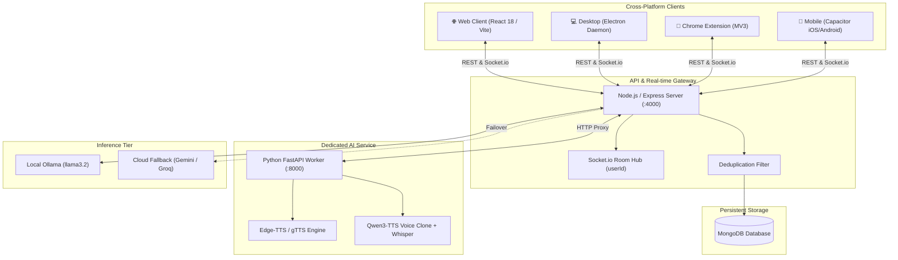

# 📋 ClipVault

<div align="center">


### **Cross-Platform Real-Time Clipboard Synchronization & AI Workspace**

Synchronize clipboard content effortlessly across **Web**, **Desktop**, **Mobile**, and **Browser Extension** with Socket.io real-time streaming, background OS monitoring, intelligent deduplication, and neural voice synthesis.

[](https://www.typescriptlang.org/)
[](https://react.dev/)
[](https://www.electronjs.org/)
[-119EFF?style=for-the-badge&logo=capacitor&logoColor=white)](https://capacitorjs.com/)
[](https://developer.chrome.com/docs/extensions/mv3/)
[](https://expressjs.com/)
[](https://fastapi.tiangolo.com/)
[](https://www.mongodb.com/)
[](https://socket.io/)

[Overview](#-overview) • [Supported Platforms](#-supported-platforms) • [Screenshots](#-screenshots) • [Key Features](#-key-features) • [Architecture](#-architecture) • [Technical Decisions](#-technical-decisions) • [Setup Guide](#-setup-guide)

</div>

---

## 📖 Overview

ClipVault is a cross-platform clipboard manager that synchronizes copied
content across Web, Desktop, Mobile, and Browser Extension clients.

Built with React, Electron, Capacitor, Node.js, Express, MongoDB, and
Socket.io, it provides real-time clipboard synchronization across
connected devices.

Beyond clipboard management, ClipVault includes rich-text notebooks,
AI-powered summarization, text-to-speech, and voice cloning.

---

## 📱 Supported Platforms

Cross-platform consistency is the core differentiator of ClipVault. The client codebase is organized as a Turborepo monorepo with 100% shared TypeScript DTOs, driving four purpose-built platform targets:

| Platform | Client Target | Core Technologies | Highlights |
| :--- | :--- | :--- | :--- |
| **Web** | Responsive Web App | React 18, Vite, Tailwind CSS v4, TipTap | Accessible from any modern browser; full dashboard, rich text notebooks, calendar history, and analytics. |
| **Desktop** | Native Desktop Client | Electron 28, TypeScript | Background OS clipboard daemon, system tray icon with quick pause/resume controls, and global drawer hotkey (`Cmd/Ctrl + Shift + V`). |
| **Mobile** | Native Mobile App | Capacitor (iOS & Android) | Native `@capacitor/clipboard` integration, app lifecycle & focus-aware syncing, mobile pull-to-refresh, responsive touch UI. |
| **Extension** | Browser Extension | Chrome Extension Manifest V3, CRXJS | Runs seamlessly in background on Chromium browsers (Chrome, Brave, Edge); auto-sniffs copied text from web pages with domain attribution. |

---

## ✨ Key Features

### 1. Cross-Device Clipboard Synchronization
Copy on your Mac or PC, and paste on your Android, iPhone, or browser instantly. ClipVault tracks clip metadata including character and word counts, creation timestamps, and source origin (e.g. `Desktop`, `Mobile`, or the specific website domain captured by the extension).

### 2. Real-Time Updates via Socket.io
Clipboard operations do not rely on aggressive HTTP polling. When any client saves a clip:
- The Express gateway broadcasts event payloads (`new_clipboard_item`, `update_clipboard_item`, `delete_clipboard_item`) directly to a private user room (`io.to(userId)`).
- All connected client sockets receive and reflect the change instantaneously with zero UI lag or redundant requests.

### 3. Background Clipboard Monitoring
Each platform utilizes an optimized listener tailored to its OS environment:
- **Desktop (Electron):** An asynchronous polling daemon checks `clipboard.readText()` every 500ms without blocking UI threads. Includes tray controls to temporarily pause monitoring during sensitive workflows (e.g., password entry).
- **Extension (Chrome MV3):** A DOM-injected content script intercepts `copy` events and extracts text or window selection with zero overhead.
- **Mobile (Capacitor):** Interacts directly with native iOS/Android pasteboards via `@capacitor/clipboard` and app resume lifecycle events.
- **Web App:** Uses modern `navigator.clipboard.readText()` with document focus heuristics to adhere to browser security sandboxes.

### 4. Smart Duplicate-Write Detection
Background clipboard listeners risk triggering infinite feedback loops: Device A copies $\to$ sends to server $\to$ broadcasts to Device B $\to$ Device B writes to OS clipboard $\to$ Device B's monitor detects a new copy $\to$ loops indefinitely.

ClipVault solves this through a robust **two-tier deduplication defense**:
1. **Client-Side Cache:** Memory-cached `lastCopiedText` references track the latest write state and discard redundant copies before dispatching network requests.
2. **Server-Side Verification:** Before saving, the backend queries the user's latest saved entry (`lastItem.text === text`). If identical, the write is safely deduplicated and returned with `200 OK` rather than duplicating database records or emitting spurious socket broadcasts.

### 5. Neural Text-to-Speech & Zero-Shot Voice Cloning *(Demonstrable)*
ClipVault integrates a dedicated AI speech service for narrating notebooks and clip summaries:
- **Multi-Accent Neural TTS:** High-fidelity Microsoft Edge neural voices across American, British, and Indian accents (male and female) with automatic fallback to `gTTS`.
- **Zero-Shot Voice Cloning:** Powered by **Qwen3-TTS** (`Qwen/Qwen3-TTS-12Hz-0.6B-Base`) and **OpenAI Whisper**. Users upload a short 5-second voice sample, Whisper transcribes the reference linguistic features, and Qwen3-TTS synthesizes clean audio matching the user's voice using custom RMS silence trimming.

### 6. Smart AI Summarization & Knowledge Organization
- Multi-tier LLM fallback pipeline: Local **Ollama** (`llama3.2:3b`) $\to$ **Google Gemini 2.5 Flash** $\to$ **Groq Cloud API**.
- Full WYSIWYG rich text notebooks built with TipTap, markdown support, task/todo manager, and analytics graphs powered by Recharts.

---

## 🏛️ Architecture

ClipVault decouples high-frequency I/O operations from heavy machine learning compute through a hybrid microservice architecture:

```
                            ┌────────────────────────────────────────┐
                            │           CLIENT ECOSYSTEM             │
                            │         (Turborepo Monorepo)           │
                            └───────────────────┬────────────────────┘
             ┌─────────────────────┬────────────┴────────────┬─────────────────────┐
             │                     │                         │                     │
             ▼                     ▼                         ▼                     ▼
┌────────────────────────┐ ┌───────────────┐ ┌──────────────────────┐ ┌────────────────────────┐
│     Web Client         │ │ Desktop Client│ │   Chrome Extension   │ │     Mobile Client      │
│ React 18 + Tailwind v4 │ │ Electron Tray │ │  Manifest V3 Worker  │ │ Capacitor (iOS/Android)│
│  TipTap + Lucide Icons │ │ Hotkey Daemon │ │ Active Tab Sniffer   │ │ @capacitor/clipboard   │
└────────────┬───────────┘ └───────┬───────┘ └──────────┬───────────┘ └───────────┬────────────┘
             │                     │                    │                         │
             └─────────────────────┼────────────────────┴─────────────────────────┘
                                   │
                                   │  HTTP REST (Auth, Clips, DTOs) &
                                   │  WebSocket (Socket.io Real-Time Rooms)
                                   ▼
                      ┌─────────────────────────┐
                      │  Node.js / Express API  │
                      │       (Port 4000)       │
                      │  • JWT Authentication   │
                      │  • Deduplication Engine │
                      │  • Socket.io Room Sync  │
                      │  • Helmet & Rate Limit  │
                      └────────────┬────────────┘
                                   │
              ┌────────────────────┴────────────────────┐
              │                                         │
              ▼                                         ▼
  ┌────────────────────────┐              ┌───────────────────────────┐
  │    MongoDB Database    │              │  Python FastAPI AI Engine │
  │       (Mongoose)       │              │        (Port 8000)        │
  │ • Users & Credentials  │              │ • Qwen3-TTS Voice Cloning │
  │ • Clipboard Items      │              │ • Whisper Transcription   │
  │ • Notebooks & Todos    │              │ • Multi-Accent Edge TTS   │
  │ • Compound Indexes     │              │ • Audio Waveform Trimming │
  └────────────────────────┘              └─────────────┬─────────────┘
                                                        │
                                    ┌───────────────────┴───────────────────┐
                                    ▼                                       ▼
                      ┌──────────────────────────┐            ┌───────────────────────────┐
                      │    Local LLM (Ollama)    │            │   Cloud LLMs (Fallback)   │
                      │       llama3.2:3b        │            │ Google Gemini / Groq API  │
                      └──────────────────────────┘            └───────────────────────────┘
```

### Mermaid Architecture Diagram



---

## 💡 Technical Decisions & Trade-Offs

### 1. Why Shared TypeScript DTOs?
- **Problem:** When maintaining four client applications (Web, Desktop, Extension, Mobile) alongside a Node.js backend, differences in data models cause subtle runtime bugs (e.g. mismatched property names, missing optional fields, or outdated timestamps).
- **Solution:** All domain entities (`ClipboardItem`, `Notebook`, `User`, `AuthResponse`) are defined in a shared package (`@clipvault/shared`) consumed across all workspaces. Any contract modification is validated at compile-time across all four platforms simultaneously.

### 2. Why Socket.io over Polling or Raw WebSockets?
- **Room-Based Isolation:** Socket.io allows partitioning client connections into authenticated private user rooms (`socket.join(userId)`). When a clip is created or modified, the backend emits the event only to that specific user's connected devices without unnecessary multi-tenant processing.
- **Resilience & Reconnection:** Built-in heartbeats, automatic reconnection backoff, and transparent HTTP long-polling fallback ensure clients reconnect gracefully across sleep states, spotty mobile networks, or desktop sleep modes.

### 3. Why Duplicate-Write Detection?
- **The "Ping-Pong" Loop Hazard:** Cross-device clipboard sync can easily trigger feedback loops. When Device A saves a clip, the server broadcasts it to Device B. If Device B writes it to the local system clipboard, its background daemon sees a new clipboard entry and attempts to send it back to the server.
- **Solution:** 
  1. Clients remember the last synced text string in local memory (`lastCopiedText`).
  2. The server compares incoming items against the user's most recent database record (`findOne().sort({ createdAt: -1 })`). If the text matches, the server returns the existing item with `200 OK` and skips socket broadcasting, guaranteeing zero database bloating and no infinite loops.

### 4. Why Decouple Node.js from the Python FastAPI AI Worker?
- Audio synthesis and neural voice cloning (PyTorch, Qwen3-TTS, Whisper) require intensive GPU/CPU tensor computations. Running inference inside a Node.js child process or native C++ addon risks starving Node's single-threaded event loop, delaying API responses and Socket.io ping intervals for all users.
- Offloading audio processing to a dedicated FastAPI worker keeps the Express API gateway lean and independently scalable.

---

## 🚀 Setup Guide

### Prerequisites
- **Node.js**: `v20.x` or higher
- **npm**: `v10.x` or higher
- **Python**: `v3.10` or higher
- **MongoDB**: Local MongoDB instance (`mongodb://localhost:27017`) or a MongoDB Atlas URI
- *(Optional)* **Ollama**: For local AI summaries (`ollama run llama3.2:3b`)

---

### 1. Backend Server Setup (Node.js & Express)

```bash
# 1. Navigate to the server directory
cd server

# 2. Install dependencies
npm install

# 3. Create .env configuration
cp .env.example .env
```

Configure your `server/.env`:
```env
PORT=4000
MONGO_URI=mongodb://localhost:27017/clipvault
JWT_SECRET=your_super_secret_jwt_key
PYTHON_WORKER_URL=http://127.0.0.1:8000
OLLAMA_BASE_URL=http://127.0.0.1:11434
OLLAMA_MODEL=llama3.2:3b
GEMINI_API_KEY=your_optional_gemini_key
GROQ_API_KEY=your_optional_groq_key
```

```bash
# 4. Start the backend in development mode
npm run dev
```
*The API gateway and Socket.io server will start on `http://localhost:4000`.*

---

### 2. Python AI & Audio Worker Setup (FastAPI)

In a new terminal:
```bash
# 1. Navigate to the python engine directory
cd server/python_engine

# 2. Create and activate a virtual environment
python3 -m venv venv
source venv/bin/activate    # On Windows: venv\Scripts\activate

# 3. Install required audio and AI packages
pip install fastapi uvicorn torch soundfile edge-tts gTTS numpy

# Optional: For local voice cloning and Whisper transcription:
# pip install openai-whisper qwen-tts

# 4. Run the worker
python3 tts_worker.py
```
*The AI audio worker will start on `http://127.0.0.1:8000`.*

---

### 3. Client Monorepo Setup (Turborepo)

From the root of the repository:
```bash
# Navigate to the client monorepo
cd client

# Install all monorepo dependencies
npm install
```

You can run everything concurrently or launch each client individually:

#### Option A: Run All Clients Concurrently
```bash
# From client/ directory:
npm run dev
```

#### Option B: Run Individual Clients

* **Web Application:**
  ```bash
  cd client/apps/web
  npm run dev
  # Open in browser: http://localhost:5173
  ```

* **Electron Desktop Client:**
  ```bash
  # Ensure the Web app is running (or built), then in another terminal:
  cd client/apps/desktop
  npm run dev
  # An Electron desktop window and tray icon will appear
  ```

* **Chrome Browser Extension:**
  ```bash
  cd client/apps/extension
  npm run build
  # Or run in watch mode: npm run dev
  ```
  1. Open Google Chrome and navigate to `chrome://extensions`.
  2. Enable **Developer mode** in the top right.
  3. Click **Load unpacked** and select the `client/apps/extension/dist` folder.

* **Capacitor Mobile Client (iOS / Android):**
  ```bash
  cd client/apps/web

  # Build web assets and sync Capacitor plugins
  npm run mobile:build

  # For Android:
  npm run mobile:sync:android
  npm run mobile:android      # Opens in Android Studio

  # For iOS (macOS required):
  npm run mobile:sync:ios
  npm run mobile:ios          # Opens in Xcode
  ```

---

## 🔒 Security & Privacy

- **Stateless JWT Authentication:** Secure tokens signed with expiration and validated on every API route and WebSocket handshake.
- **Strict Network Headers:** Configured with `helmet` for Cross-Origin Resource Policy protection, scoped CORS rules, and rate limiting (1000 requests per 15 minutes).
- **User Privacy Control:** Background clipboard monitoring can be toggled on/off instantly via the Desktop system tray or Extension popup to prevent syncing sensitive credentials.

---

## 👥 Author

**Vanshika Tomar**
- GitHub: [@vanshikatomar747](https://github.com/vanshikatomar747)
- Repository: [clipvault-client](https://github.com/vanshikatomar747/clipvault-client)

---

<div align="center">
⭐ <i>If you find ClipVault helpful, please star the repository!</i> ⭐
</div>
